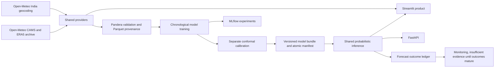

# AirCast: India Air Quality Intelligence Platform

A working local beta for nationwide air-quality discovery and calibrated next-day PM2.5 forecasting. Public repository: https://github.com/mdhasim-1406/aircast. A hosted Streamlit URL has not yet been verified; Community Cloud sign-in is required.

## What it does
Search 54 curated Indian cities or dynamically geocode other Indian towns, inspect six pollutants and explicitly labelled US AQI, compare cities and view provider history/forecasts. Custom model coverage is separate: Bengaluru, Chennai, Delhi, Kolkata and Mumbai. Provider coverage does not imply trained-model coverage.

All current air-quality values are real Open-Meteo CAMS atmospheric model estimates, not direct ground-station observations. OpenAQ returned HTTP401 without credentials. Do not use AirCast as health advice or a ground-monitor substitute. Responses are cached for 15 minutes; manual refresh clears the provider cache. Source estimate and retrieval timestamps are displayed.

## Architecture


## Run locally
Python 3.12 is required. The deployment is CPU-only and does not need an API server or MLflow server.

```bash
python3.12 -m venv .venv
.venv/bin/python -m pip install -r requirements.txt
PYTHONPATH=src .venv/bin/streamlit run streamlit_app.py --server.port 8520
PYTHONPATH=src .venv/bin/uvicorn api.main:app --port 8020
```
Open http://localhost:8520 and http://localhost:8020/docs. On Windows use `.venv\Scripts\python` and set `PYTHONPATH=src`. Convenience setup scripts and start_command.md are included.

## Reproduce training
```bash
.venv/bin/python -m pip install 'mlflow==3.18.0'
PYTHONPATH=src .venv/bin/python scripts/ingest_multicity.py
PYTHONPATH=src .venv/bin/python scripts/train_probabilistic.py
PYTHONPATH=src .venv/bin/python -m pytest -q
```
Training never occurs on app startup. Legacy Chennai artifacts are preserved separately; platform inference uses artifacts/probabilistic/current.json and its version directory. Training defaults to local MLflow tracking, not a required runtime service. For MLflow UI use `.venv/bin/mlflow ui --backend-store-uri sqlite:///mlflow.db --port 5020`.

## Dataset and validation
Actual multicity training snapshot: 7,095 daily records, 1,419 per city, 2023-01-01 through 2026-11-19. ERA5 archive lag accounts for the earlier historical cutoff. Fresh custom inference separately obtains recent completed CAMS days. Training snapshot has zero missing PM2.5, duplicated city-days, negative PM2.5, incomplete days or seven-day flatline flags under the current rules. See artifacts/platform/quality.json and provenance.json for exact evidence and hash. The inspected snapshot had 100% hourly completeness; that is not a guarantee for future requests. Pollution peaks are retained, not blindly clipped.

## Forecasting and evaluation
At the end of IST day t, predict mean PM2.5 on t+1. Past-only lags and rolling statistics plus cyclic calendar features feed per-city estimators. The current models do not use the downloaded weather covariates, pooled city identifiers or a Diwali feature; these remain limitations. A seasonal-naive target uses day t-6, exactly seven days before t+1.

Shared absolute target-date boundaries: train through 2025-05-06, validation through 2025-12-03, calibration through 2026-04-22, test 2026-04-23 through 2026-11-19. Validation selects the point estimator; no final-test tuning. Preprocessing fits on permitted training data. Separate LightGBM P10/P50/P90 models are trained, ordered and expanded with finite-sample conformal calibration from the held-out calibration interval. Nominal 80% is not guaranteed under temporal dependence or shift.

Actual saved test results for version 20261125T160022Z:

| City | Selected point estimator | MAE | RMSE | R2 | Persistence MAE | Interval coverage | Mean width µg/m³ |
|---|---|---:|---:|---:|---:|---:|---:|
| Bengaluru | Persistence | 3.496 | 5.214 | .771 | 3.496 | 95.3% | 18.46 |
| Chennai | Ridge | 3.695 | 5.588 | .708 | 3.875 | 88.6% | 15.97 |
| Delhi | Persistence | 17.435 | 23.775 | .556 | 17.435 | 74.4% | 54.68 |
| Kolkata | Ridge | 9.145 | 12.755 | .828 | 9.729 | 68.2% | 27.27 |
| Mumbai | Persistence | 4.299 | 6.763 | .900 | 4.299 | 83.4% | 16.35 |

A complex model does not automatically win: persistence remains selected for three cities. Kolkata and Delhi intervals under-cover relative to the nominal 80%; Bengaluru intervals are conservative. These are observed failure modes, not claims of guaranteed uncertainty. The point forecast may differ from the quantile median; the interval is calibrated around the quantile models. Backtest CSV includes expanding-origin Ridge evaluations. Train/validation errors in the existing release need care because selected Ridge was refit on validation data; do not use those numbers as unbiased generalization diagnostics.

Random splitting is inappropriate because future regimes and overlapping windows contaminate an earlier forecasting task. No future realized pollution or centered windows are used. Held-out targets are not imputed. MLflow logs experiments and artifacts but does not itself prove correctness.

## Verification and known limits
22 deterministic automated tests passed both in the project environment and a fresh runtime environment. Live API checks passed for ten cities. Local Playwright exercised city switching, custom forecast, unsupported-city provider forecast, comparison, data quality, model intelligence and smaller-town search with no page errors. A 390px viewport had no horizontal overflow. Screenshots are under reports/browser locally.

Current limitations: no ground-station integration, no validated weather-feature model, no custom geographic generalization beyond five cities, incomplete operational drift pipeline and no matured live outcome history. Monitoring honestly says insufficient data. Scheduled workflow/configuration must be reviewed separately from proof of a completed scheduled run. Community Cloud ephemeral disk is not durable monitoring storage. Docker and hosted verification status must not be inferred from local tests.

## Cloud deployment
Select this public repo, branch main and entrypoint streamlit_app.py at https://share.streamlit.io/, using Python3.12. Bundled models and Parquet remove any dependency on a laptop or local server. No secrets are required for Open-Meteo. Sign-in/account authorization is still necessary. A deployment is accepted only after the actual hosted URL and interactions are exercised.

## Further documentation
- [Model card](MODEL_CARD.md): forecasting scope, evaluation and limitations.
- [Dataset documentation](DATASET.md): sources, coverage and data quality.
